# Base de datos — Aurum Condominios

PostgreSQL, versionada con **Flyway** (`api/src/main/resources/db/migration`, V1 a V13).
Todas las tablas usan `UUID` como clave primaria (`gen_random_uuid()`).
Este documento refleja el esquema real después de la **revisión de la Fase 4**
(octubre 2026), generado a partir de la base, no de memoria.

## Diagrama entidad-relación

```mermaid
erDiagram
    ROLES ||--o{ USUARIOS : "tiene"
    ROLES ||--o{ ROL_PERMISO : ""
    PERMISOS ||--o{ ROL_PERMISO : ""
    TIPOS_DOCUMENTO ||--o{ USUARIOS : ""
    TIPOS_DOCUMENTO ||--o{ RESIDENTES : ""
    TIPOS_RESIDENTE ||--o{ RESIDENTES : ""
    TIPOS_OCUPACION ||--o{ APARTAMENTOS : ""
    ESTADOS_CUENTA ||--o{ APARTAMENTOS : ""
    ESTADOS ||--o{ PARQUEADEROS : ""
    ESTADOS ||--o{ SALONES_SOCIALES : ""

    USUARIOS ||--o{ USUARIO_APARTAMENTO : "es propietario de"
    APARTAMENTOS ||--o{ USUARIO_APARTAMENTO : ""
    APARTAMENTOS ||--o{ VEHICULOS : "tiene"
    PARQUEADEROS |o--o{ VEHICULOS : "asignado a"

    USUARIOS ||--o{ RESERVA_SALON_SOCIAL : "reserva"
    SALONES_SOCIALES ||--o{ RESERVA_SALON_SOCIAL : ""
    USUARIOS ||--o{ SOLICITUD_RESERVA_EXCEPCIONAL : "solicita"
    SALONES_SOCIALES ||--o{ SOLICITUD_RESERVA_EXCEPCIONAL : ""
    USUARIOS |o--o{ SOLICITUD_REGISTRO : "revisa"

    APARTAMENTOS ||--o{ PAQUETES : "recibe"

    RESIDENTES ||--o{ REGISTRO_VISITANTE : "visita a pie"
    APARTAMENTOS ||--o{ REGISTRO_VISITANTE : ""
    RESIDENTES ||--o{ REGISTRO_PARQUEADERO_VISITANTE : "visita en vehículo"
    PARQUEADEROS ||--o{ REGISTRO_PARQUEADERO_VISITANTE : ""
    APARTAMENTOS |o--o{ REGISTRO_PARQUEADERO_VISITANTE : ""
    RESIDENTES ||--o{ REGISTRO_ACCESO_PISCINA : "ingresa"
    APARTAMENTOS ||--o{ REGISTRO_ACCESO_PISCINA : ""

    USUARIOS {
        uuid id PK
        varchar numero_documento UK
        varchar correo UK "único sin mayúsculas"
        varchar contrasena "hash BCrypt"
        boolean activo
    }
    RESIDENTES {
        uuid id PK
        varchar numero_documento UK "texto desde V12"
        varchar nombre
        varchar apellido
        bigint celular
        boolean activo
    }
    APARTAMENTOS {
        uuid id PK
        varchar numero UK
        boolean activo
    }
    VEHICULOS {
        uuid id PK
        varchar placa "única mientras esté activa"
        varchar tipo "CARRO | MOTO"
        boolean activo
    }
    REGISTRO_VISITANTE {
        uuid id PK
        timestamp fecha_hora_entrada "TIMESTAMP desde V13"
        timestamp fecha_hora_salida "null = sigue adentro"
    }
    RESERVA_SALON_SOCIAL {
        uuid id PK
        timestamp fecha_y_hora_reserva "única por salón"
    }
```



## Tablas

| Grupo | Tablas | Para qué |
|---|---|---|
| **Catálogos** | `roles`, `tipos_documento`, `tipos_ocupacion`, `estados_cuenta`, `estados`, `tipos_residente` | Valores fijos referenciados por FK. Únicos sin distinguir mayúsculas. |
| **Seguridad** | `permisos`, `rol_permiso` | Permisos dinámicos: qué rol puede ver/editar cada módulo (pantalla Roles y Permisos). |
| **Personas** | `usuarios`, `residentes` | `usuarios` = cuentas que inician sesión (admin, propietarios, portería). `residentes` = personas sin cuenta: visitantes, arrendatarios. |
| **Inmuebles** | `apartamentos`, `parqueaderos`, `salones_sociales` | Se desactivan, nunca se borran (`activo`). |
| **Propiedad** | `usuario_apartamento`, `vehiculos` | Quién es propietario de cada apartamento (muchos a muchos) y sus vehículos. |
| **Operación** | `reserva_salon_social`, `solicitud_reserva_excepcional`, `solicitud_registro`, `paquetes` | Reservas, colas de aprobación y recepción de paquetes. |
| **Portería** | `registro_visitante`, `registro_parqueadero_visitante`, `registro_acceso_piscina` | Historial de ingresos y salidas. |

## Lo que encontró y corrigió la revisión (Fase 4)

| # | Problema | Impacto real | Corrección |
|---|---|---|---|
| 1 | Los repositorios **creaban catálogos en silencio** si el nombre no coincidía exacto, y `/api/catalogos/todos` devolvía listas escritas a mano distintas a la base. | Había un rol **"Administrador" sin ningún permiso** (con un usuario dentro), "Al dia" junto a "Al día" (por eso "AL DÍA" salía como mora), un tipo de ocupación "Propietario" inexistente y "Cédula de Ciudadanía" duplicada con la codificación rota. | `CatalogoResolver` (sin mayúsculas/tildes, traduce nombres largos, rechaza lo que no existe con 400). Catálogos leídos de la base. **V10** unifica duplicados e impide nuevos. |
| 2 | **24 llaves foráneas sin índice** (Postgres no las indexa solo). | Cada consulta por apartamento, salón, visitante… recorre la tabla completa al crecer. | **V11**: índice en las 24 + índices parciales para "visitantes adentro" y "paquetes pendientes". |
| 3 | Reglas solo en código: dos reservas del mismo salón a la misma hora, correos repetidos con distintas mayúsculas, estados de solicitud libres. | Una carrera de dos peticiones simultáneas podía colarse. | **V11**: `UNIQUE (salon_id, fecha_y_hora_reserva)`, `UNIQUE lower(correo)`, `CHECK` de estados. |
| 4 | `residentes.numero_documento` era **INTEGER**. | No cabían documentos > 2.147.483.647 ni pasaportes con letras. | **V12**: `VARCHAR(20)`, como en `usuarios`. Normalización única en `ResidenteModel`. |
| 5 | Fechas de visitas guardadas como **texto** (`VARCHAR(30)`), herencia de MongoDB. | Ordenar/filtrar por día dependía del formato del texto; la base no podía validar ni calcular duraciones. | **V13**: `TIMESTAMP`, entrada obligatoria, salida ≥ entrada, índices por fecha. |

Reglas de negocio relacionadas que ya aplica el código (no la base):

- **Nada desactivado se puede usar** (`RequiereActivo`): reservas, paquetes, visitas, piscina, vehículos. Un usuario desactivado pierde el acceso de inmediato aunque tenga la sesión abierta.
- Un visitante solo queda bloqueado mientras **sigue adentro** (antes no podía volver nunca al mismo apartamento).

## Recomendaciones pendientes (no aplicadas todavía)

1. **Dos tablas de personas** (`usuarios` y `residentes`). Un propietario es un `usuario`; un visitante o arrendatario es un `residente`; `tipos_residente` incluye "Propietario", que se solapa con el rol PROPIETARIO. Funciona, pero conviene decidir un modelo único de "persona" antes de crecer (afecta API y app).
2. **Auditoría**: ni las visitas ni los paquetes guardan **qué funcionario** los registró. Recomendado agregar `registrado_por_usuario_id` (útil ante reclamos). Candidato para la Fase 6 (visitas autorizadas).
3. `apartamentos.medidas` / `parqueaderos.medidas` son texto (`"80"`); deberían ser `NUMERIC(8,2)`. `telefono` como `BIGINT` pierde ceros a la izquierda y extensiones; mejor `VARCHAR(20)`.
4. `solicitud_registro.nombre_tipo_documento` guarda el tipo como texto, no como FK a `tipos_documento`.
5. `registro_parqueadero_visitante.apartamento_id` admite nulo (registros viejos); los nuevos siempre lo llenan.
6. Zona horaria: las fechas son `TIMESTAMP` sin zona. Correcto mientras todo opere en Colombia; si el servidor en la nube corre en UTC, fijar `-Duser.timezone=America/Bogota` o migrar a `TIMESTAMPTZ`.

## Cómo consultar el esquema

```bash
psql -U postgres -d gescazone -c "\dt"                 # tablas
psql -U postgres -d gescazone -c "\d+ registro_visitante"  # columnas, índices y restricciones
psql -U postgres -d gescazone -c "select version, description from flyway_schema_history order by installed_rank;"
```
